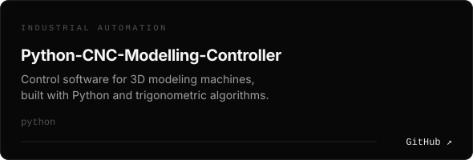
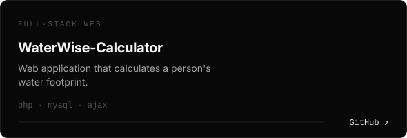
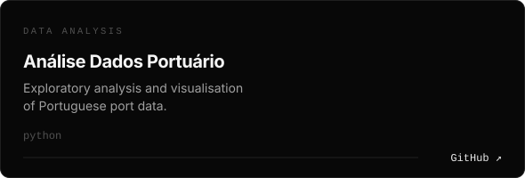
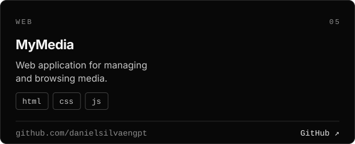
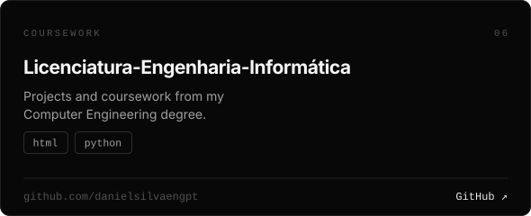
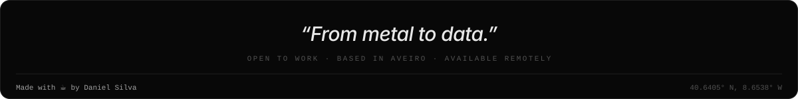

 

&nbsp;

&nbsp;

 

Computer Engineering student (Information Systems & AI) and **Medal of Excellence** winner at WorldSkills Portugal 2023, in Mobile Application Development.

I build autonomous agents, RAG architectures and data pipelines, from raw data to a system that actually runs. My path started in hands-on, technical work, and that's where the idea comes from:

> *From metal to data.*

 

| | |
|---|---|
| **Autonomous Agents** | LLM orchestration, tool use and agentic workflows |
| **RAG Architectures** | Embeddings and vector search  |
| **Data Engineering** | ETL pipelines, modelling and analysis in Python and SQL |

 

 

<table>
<tr>
<td></td>
<td></td>
</tr>
<tr>
<td></td>
<td></td>
</tr>
<tr>
<td></td>
<td></td>
</tr>
</table>

 

**🏅 Medal of Excellence**, WorldSkills Portugal 2023 · Mobile Application Development

**BSc in Computer Engineering**, Information Systems & AI (in progress)

 

