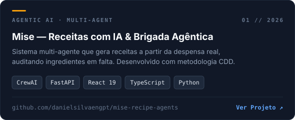
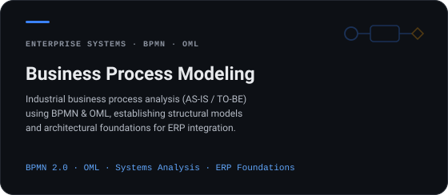
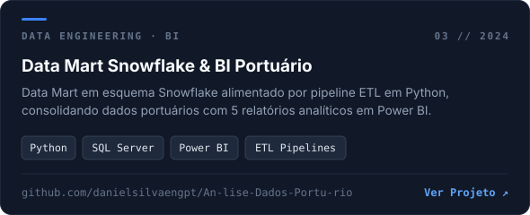
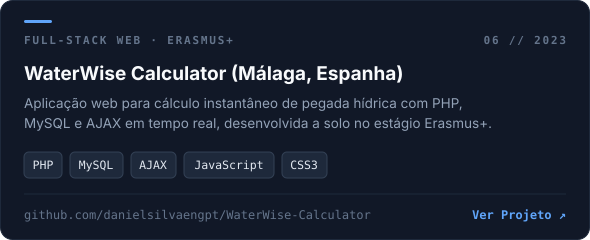
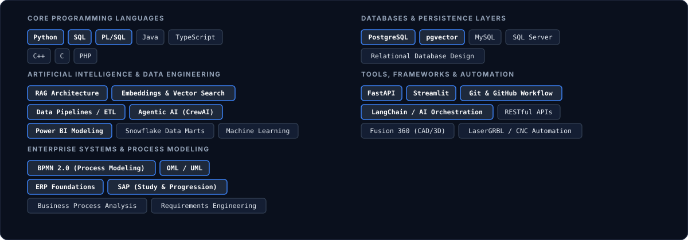

  

&nbsp;

&nbsp;

 

## Sobre mim // About

Concluí a Licenciatura em Engenharia Informática no ISEC (ramo de Sistemas de Informação), passei por 4 estágios profissionais — incluindo uma experiência internacional Erasmus+ em Espanha — e conquistei a **Medalha de Excelência** em Desenvolvimento de Aplicações Móveis no **WorldSkills Portugal 2023** (nível nacional).

A minha experiência inicial em ambientes industriais com máquinas CNC ensinou-me o valor do rigor e do pensamento sistemático. Hoje foco essa disciplina em arquiteturas RAG, pipelines de dados, modelação analítica, modelação de processos de negócio (**BPMN / OML / fundações ERP**) e desenvolvimento backend robusto em Python. O meu estágio mais recente foi como **Engenheiro de IA na Meight**, integrado na equipa de dados em arquiteturas de Hybrid Search (`pgvector`, embeddings densos e esparsos) e ferramentas internas de onboarding operacional.

> *“Construo sistemas que ligam dados, processos de negócio e inteligência artificial. Da análise ao impacto.”*

 

## Percurso // From metal to data

 

## Projetos em destaque // Selected projects

 

### Demonstrações &amp; Relatórios técnicos:
- ⚡ **Mise — Receitas com IA:** [Aplicação Web em direto ↗](https://mise-recipe-agents.vercel.app/)
- 🔬 **DermoScan AI:** [Demonstração Streamlit ↗](https://dermoscanai.streamlit.app/)
- 📑 **Modelação de Processos &amp; OML:** [Relatório Técnico Optima (PDF) ↗](https://github.com/danielsilvaengpt/Business-Process-Modeling/blob/main/report/EO_Relatorio_Completo_Optima.pdf)
- 📊 **BI &amp; Data Mart Portuário:** [Dashboards e Resultados em Power BI (PDF) ↗](https://github.com/danielsilvaengpt/An-lise-Dados-Portu-rio/blob/main/PowerBI_analise_Imagens_Resultados.pdf)
- 🌐 **Portfólio Interativo:** [danielsilvaengpt.github.io/portfolio ↗](https://danielsilvaengpt.github.io/portfolio/)

 

## Competências técnicas // Skills &amp; Stack

 

## Educação &amp; Distinções // Education &amp; Honors

- 🏅 **Medalha de Excelência**, WorldSkills Portugal 2023 · Desenvolvimento de Aplicações Móveis (Nível Nacional)
- 🎓 **Licenciatura em Engenharia Informática**, Ramo de Sistemas de Informação · Instituto Superior de Engenharia de Coimbra (ISEC)
- 🇪🇸 **Estágio Erasmus+**, Internet Web Solutions (Málaga, Espanha) · Desenvolvimento Web Full-Stack (PHP &amp; MySQL)
- ⚙️ **Estágios Industriais**, OPTIMA Equipamentos CNC · Desenvolvimento de Software CNC &amp; IT Industrial

 

<strong>🇬🇧 English Overview</strong>

 

### Daniel Silva — Junior Computer Engineer
*“From analysis to impact.”*

I graduated in Computer Engineering from ISEC (Information Systems track), completed four internships — including an international Erasmus+ experience in Málaga, Spain — and won the **Medal of Excellence** at WorldSkills Portugal 2023 (Mobile Application Development).

My trajectory bridges industrial precision from CNC machinery with AI and Data Engineering. My latest role was as an **AI Engineer Intern at Meight**, working on Hybrid Search pipelines (`pgvector`, dense semantic and keyword search) and operational customer onboarding automation.

Open to new opportunities in **Data &amp; AI Engineering**, **Enterprise Systems &amp; Process Modeling (ERP / SAP)**, **Data Analytics**, or **Python Backend Development**.

