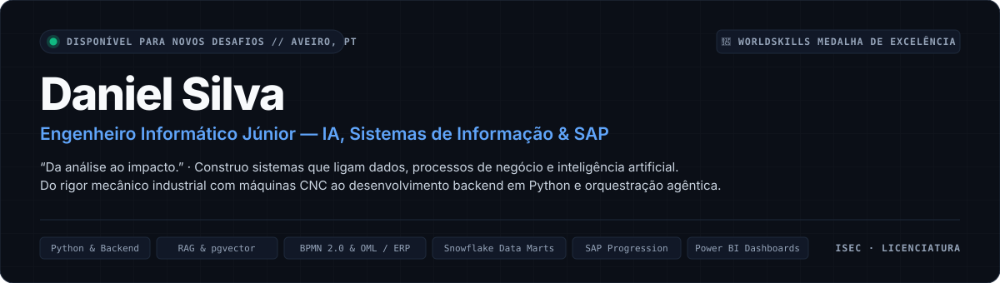
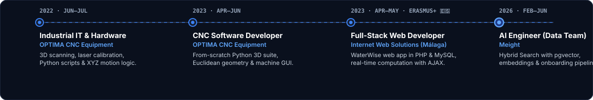
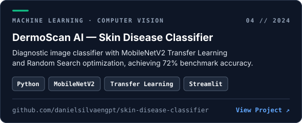
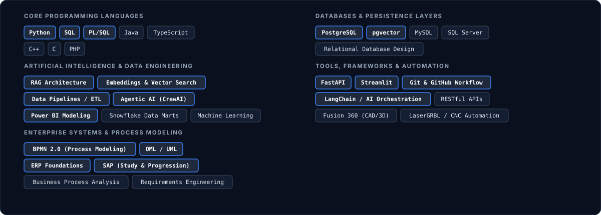

  

&nbsp;

&nbsp;

 

## About Me

I graduated in Computer Engineering from ISEC (Information Systems track), completed four professional internships — including an international Erasmus+ experience in Málaga, Spain — and won the **Medal of Excellence** in Mobile Application Development at **WorldSkills Portugal 2023** (national level).

My background in industrial environments with CNC machinery instilled a deep discipline for precision and systematic architecture. Today, I channel that rigor into RAG architectures, data pipelines, analytical modeling, business process modeling (**BPMN / OML / ERP foundations**), and robust Python backend engineering. Most recently, I interned as an **AI Engineer at Meight**, working in the data team on Hybrid Search architectures (`pgvector`, dense semantic vectors & sparse BM25 retrieval) and automated customer onboarding systems.

> *“I build systems that connect enterprise data, business processes, and artificial intelligence. From analysis to impact.”*

 

## Career Journey // From Metal to Data

 

## Featured Projects

 

### Live Demos &amp; Technical Reports:
- 🔬 **DermoScan AI:** [Live Streamlit Diagnostic Demo ↗](https://dermoscanai.streamlit.app/)
- 📑 **Business Process Modeling &amp; OML:** [Technical Optima Report (PDF) ↗](https://github.com/danielsilvaengpt/Business-Process-Modeling/blob/main/report/EO_Relatorio_Completo_Optima.pdf)
- 📊 **Port BI &amp; Data Mart:** [Power BI Dashboards &amp; Analysis (PDF) ↗](https://github.com/danielsilvaengpt/An-lise-Dados-Portu-rio/blob/main/PowerBI_analise_Imagens_Resultados.pdf)
- 🌐 **Interactive Portfolio:** [danielsilvaengpt.github.io/portfolio ↗](https://danielsilvaengpt.github.io/portfolio/)

 

## Technical Skills &amp; Architecture Stack

 

## Education &amp; Honors

- 🏅 **Medal of Excellence**, WorldSkills Portugal 2023 · Mobile Application Development (National level)
- 🎓 **BSc in Computer Engineering**, Information Systems track · Instituto Superior de Engenharia de Coimbra (ISEC)
- 🇪🇸 **Erasmus+ Internship**, Internet Web Solutions (Málaga, Spain) · Full-Stack Web Development (PHP &amp; MySQL)
- ⚙️ **Industrial Internships**, OPTIMA CNC Equipment · CNC Software Development &amp; Industrial IT/Hardware

 

<strong>🇵🇹 Versão em Português</strong>

 

### Daniel Silva — Engenheiro Informático Júnior
*“Da análise ao impacto.”*

Concluí a Licenciatura em Engenharia Informática no ISEC (ramo de Sistemas de Informação), passei por 4 estágios profissionais — incluindo uma experiência internacional Erasmus+ em Espanha — e conquistei a **Medalha de Excelência** em Desenvolvimento de Aplicações Móveis no **WorldSkills Portugal 2023** (nível nacional).

A minha experiência inicial em ambientes industriais com máquinas CNC ensinou-me o valor do rigor e do pensamento sistemático. Hoje foco essa disciplina em arquiteturas RAG, pipelines de dados, modelação analítica, modelação de processos de negócio (**BPMN / OML / fundações ERP**) e desenvolvimento backend robusto em Python. O meu estágio mais recente foi como **Engenheiro de IA na Meight**, integrado na equipa de dados em arquiteturas de Hybrid Search (`pgvector`, embeddings densos e esparsos) e ferramentas internas de onboarding operacional.

Atualmente disponível para novos desafios em **Engenharia de Dados / IA**, **Sistemas de Informação &amp; Modelação de Processos (ERP / SAP)**, **Análise de Dados** ou **Backend Python Developer**.

