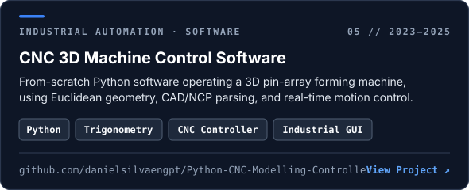
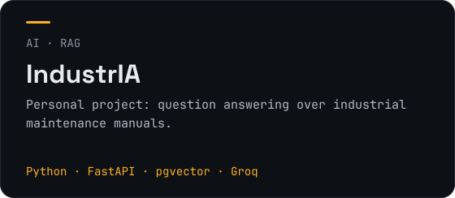
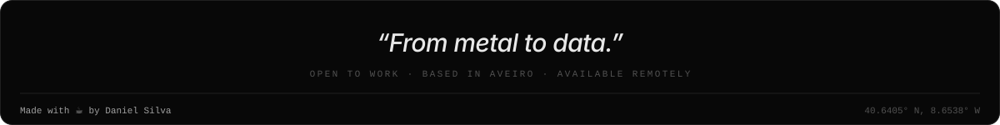

 

&nbsp;

&nbsp;

  

  <strong>Junior Computer Engineer — AI, Information Systems &amp; SAP</strong> 
  <em>“From analysis to impact.”</em> · Aveiro, Portugal · Open to new opportunities

 

I hold a degree in Computer Engineering (Information Systems track) from ISEC, completed four professional internships (including an international Erasmus+ experience in Spain), and was awarded the **Medal of Excellence** at WorldSkills Portugal 2023 (Mobile Application Development, national level).

I build systems connecting data, business processes, and artificial intelligence. My trajectory bridges mechanical precision with CNC machines to RAG architectures, analytical modeling, and robust backend engineering in Python. Most recently, I interned as an **AI Engineer at Meight**, working on Hybrid Search architectures with `pgvector` and operational customer onboarding automation.

> *“From analysis to impact.”* · *From metal to data.*

 

| Domain | Core Focus &amp; Applied Work |
|---|---|
| **Autonomous Agents &amp; AI** | Multi-agent orchestration (CrewAI), RAG architectures, LLM grounding &amp; deterministic retrieval |
| **Data Engineering &amp; BI** | Vector search (`pgvector`), Snowflake schema Data Marts, ETL pipelines in Python, Power BI dashboards |
| **Enterprise Systems &amp; ERP** | Business process analysis (BPMN 2.0 / OML), industrial AS-IS &amp; TO-BE modeling, SAP progression |

 

 

  
  
  
  
  
  

  <a href="https://mise-recipe-agents.vercel.app/">⚡ Live demo Mise (Agentic AI)</a> ·
  <a href="https://dermoscanai.streamlit.app/">🔬 Live demo DermoScan AI</a> ·
  <a href="https://github.com/danielsilvaengpt/Business-Process-Modeling/blob/main/report/EO_Relatorio_Completo_Optima.pdf">📑 Relatório BPMN &amp; OML (PDF)</a> ·
  <a href="https://github.com/danielsilvaengpt/An-lise-Dados-Portu-rio/blob/main/PowerBI_analise_Imagens_Resultados.pdf">📊 Power BI Dashboards (PDF)</a> ·
  <a href="https://github.com/danielsilvaengpt/WaterWise-Calculator">💧 WaterWise Calculator (Erasmus+)</a>

 

- **🏅 Medal of Excellence**, WorldSkills Portugal 2023 · Mobile Application Development (National level)
- **🎓 BSc in Computer Engineering**, Information Systems track · Instituto Superior de Engenharia de Coimbra (ISEC)
- **🌍 Erasmus+ Internship**, Internet Web Solutions (Málaga, Spain) · Full-Stack Web Development (PHP &amp; MySQL)
- **⚙️ Industrial IT &amp; CNC Internships**, OPTIMA · Software Development &amp; Industrial Hardware / Additive Manufacturing

 

<strong>🇵🇹 Versão em Português</strong>

 

### Daniel Silva — Engenheiro Informático Júnior
*“Da análise ao impacto.”*

Concluí a Licenciatura em Engenharia Informática no ISEC (ramo de Sistemas de Informação). Ao longo do meu percurso, realizei quatro estágios profissionais — incluindo uma experiência internacional Erasmus+ em Espanha — e conquistei a **Medalha de Excelência** em Desenvolvimento de Aplicações Móveis no **WorldSkills Portugal 2023** (nível nacional).

A minha experiência inicial em ambientes industriais com máquinas CNC ensinou-me o valor do rigor e do pensamento sistemático. Hoje foco essa capacidade em arquiteturas RAG, pipelines de dados, modelação analítica, modelação de processos de negócio (**BPMN / OML / fundações ERP**) e desenvolvimento backend robusto em Python. O meu estágio mais recente foi como **Engenheiro de IA na Meight**, integrado na equipa de dados em arquiteturas de Hybrid Search (`pgvector`, embeddings densos e esparsos) e ferramentas internas de onboarding operacional.

Atualmente disponível para novos desafios em **Engenharia de Dados / IA**, **Sistemas de Informação & Modelação de Processos (ERP / SAP)**, **Análise de Dados** ou **Backend Python Developer**.

 

