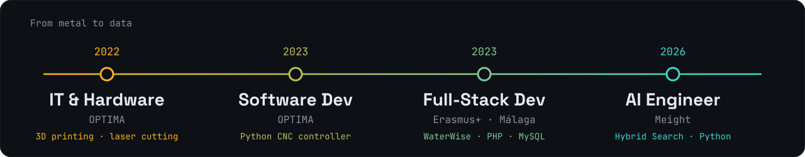
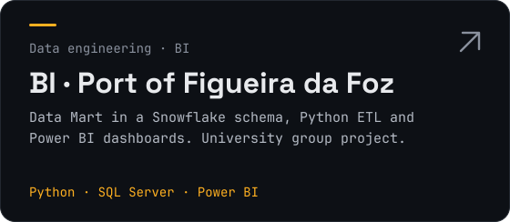
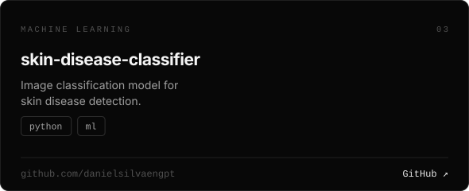
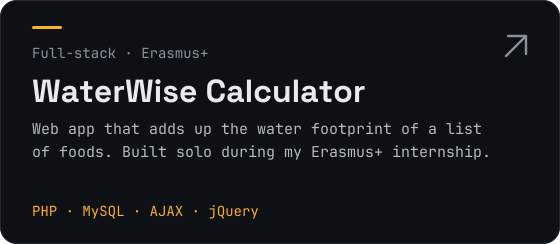
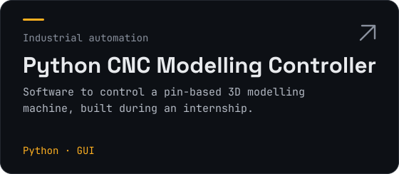
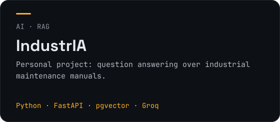
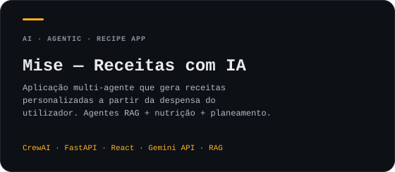
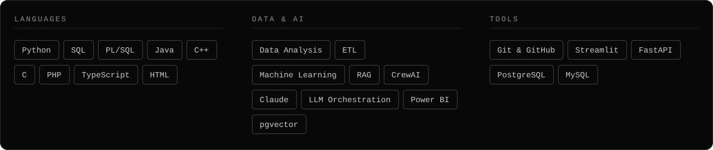

  

  
  
  

I finished my degree in Computer Engineering (Information Systems track) at ISEC, did four internships, one of them in Spain through Erasmus+, and won the **Medal of Excellence** at WorldSkills Portugal 2023 (Mobile Application Development, national level).

I started my IT Career with CNC machines and industrial automation and moved towards data and AI. My latest internship was as an **AI Engineer at Meight**, in the data team of a Hybrid Search project (Feb–Jun 2026).

## From metal to data

## Selected projects

  
  
  
  
  
  

  <a href="https://dermoscanai.streamlit.app/">Live demo of the skin disease classifier</a> ·
  <a href="https://github.com/danielsilvaengpt/An-lise-Dados-Portu-rio/blob/main/PowerBI_analise_Imagens_Resultados.pdf">Power BI dashboards (PDF)</a> ·
  <a href="https://mise-recipe-agents.vercel.app/">Mise — Receitas com IA a partir da tua despensa</a>

## Skills

Português

Terminei Engenharia Informática no ISEC, no ramo de Sistemas de Informação, fiz quatro estágios (um deles em Espanha, com o Erasmus+) e ganhei a Medalha de Excelência no WorldSkills Portugal 2023 (Desenvolvimento de Aplicações Móveis, nível nacional).

Comecei nas máquinas CNC e na automação industrial e fui avançando para os dados e a IA. O último estágio foi como **IA Engineer na Meight**, na equipa de dados de um projeto de Hybrid Search (Fev–Jun 2026).

Procuro a minha primeira função como **Analista de Dados**, **Engenheiro de Dados/IA** ou **Backend Python Developer**.

